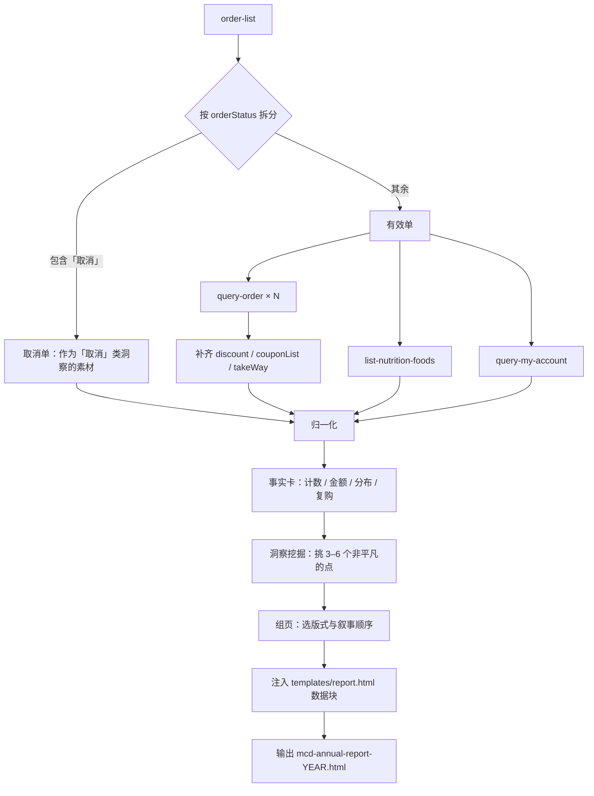

# 麦当劳 MCP 集成说明

本文说明「麦麦的点名册」实际调用的麦当劳 MCP Server、Tool、调用流程与业务价值。
所有结论均来自真实调用与实测，不包含推测。

---

## 1. 使用的 MCP Server

| 项 | 内容 |
|---|---|
| Server | 麦当劳官方 MCP Server |
| 认证方式 | 用户账号授权（OAuth / 登录态由 MCP 客户端托管） |
| 连接配置 | 不在仓库中保存任何 Token、密钥或凭证；由客户端的环境变量 / 授权流程注入 |
| 依赖形态 | 无额外 SDK、无非官方接口 |

> 合规说明：仓库内不包含真实 Token、密钥、账号凭证，也不包含他人个人信息。

---

## 2. 使用的 Tool

| # | Tool | 入参 | 用途 | 关键返回字段 |
|---|---|---|---|---|
| 1 | `order-list` | 无 | 拉取订单主数据，是整份报告的数据源 | `orderId` `createTime` `storeCode` `storeName` `orderStatus` `orderProductList[]` `realTotalAmount` |
| 2 | `query-order` | `orderId` | 逐单补齐优惠、券、取餐方式 | `totalDiscountAmount` `couponList[]` `takeWay` `productPrice` `realTotalAmount` |
| 3 | `list-nutrition-foods` | 无 | 解析热量表，用于娱乐性估算 | `productName` `energyKcal` |
| 4 | `query-my-account` | 无 | 读取积分，用于收尾页彩蛋 | `availablePoint` `accumulativePoint` |

工具 3、4 为**可选**：任一失败时报告照常生成，只是对应页面不出现。

---

## 3. 调用流程



### 步骤拆解

1. **拉取订单**
   调用 `order-list`。该接口**不接受任何参数**（无日期范围、无分页），返回其时间窗口内的订单。

2. **拆分有效单与取消单**
   按 `orderStatus` 是否包含「取消」区分。取消单不计入消费、门店、口味等聚合，但单独统计金额，可作为「取消」类洞察的素材。

3. **逐单补详情**
   对每笔有效订单调用 `query-order`。订单数较多时优先补最近 20 笔，其余用列表字段兜底。

4. **营养表（可选）**
   调用 `list-nutrition-foods`，解析为 `{商品名: kcal}` 映射。是否值得单独成一页由你判断；若使用必须标注「娱乐估算」与匹配率。

5. **积分（可选）**
   调用 `query-my-account`，取 `availablePoint`。

6. **算事实卡**
   按固定公式算出订单数、总消费、笔均、时段 / 星期 / 月份分布、门店与城市、复购榜、品类结构、优惠与取消。金额保留真实小数。

7. **挖掘洞察并组页**
   按 `references/insight-playbook.md` 的标准挑出 3–6 个「可指认 + 非平凡」的点，再用 `references/report-schema.md` 的版式组装页面，决定页数、顺序与配色节奏。

8. **生成报告**
   把 `meta` + `pages` 写入模板数据块。模板只负责排版与翻页，**不含任何业务文案或指标**。

### 调用次数

`2 + N`（N = 有效订单数），另有 2 次可选调用。

---

## 4. 字段映射

| MCP 字段 | 归一化字段 | 处理规则 |
|---|---|---|
| `realTotalAmount` | `amount` | 字符串转数字 |
| `orderStatus` | `status` | 用于拆分有效 / 取消 |
| `createTime` | `createTime` | 时段画像、日期叙事的唯一来源 |
| `storeCode` | `storeCode` | **门店聚合主键** |
| `storeName` | `storeName` | 仅用于展示；同一门店存在带 / 不带「麦当劳」前缀两种写法 |
| `orderProductList[].productName` | `items[].name` | 见下方归一化规则 |
| `orderProductList[].comboItemList` | `items[]` | 需判断是「真实子项」还是「特调说明」 |
| `totalDiscountAmount` | `discount` | 优惠类洞察的依据 |
| `couponList[]` | `coupons` | 券数量统计 |
| `takeWay` | `takeWay` | 堂食 / 外带等 |

### 归一化的三个坑（均已实测并处理）

1. **套餐与特调混在同一个字段**
   `comboItemList` 既可能装套餐子项，也可能装定制说明。
   实测样本：`大杯鲜萃咖啡` 的子项是 `奶油球(不要)/白砂糖(不要)`；而 `可乐` 的子项是真实商品 `可乐大杯`。
   规则：命中特调特征（括号、斜杠、「不要 / 不加 / 少 / 多 / 去 / 加 / 换」）则丢弃，否则视为真实子项并丢弃父商品名，避免重复计数。

2. **同一家店两种名字**
   实测同一门店返回过 `温州乐清银祥大厦餐厅` 与 `麦当劳温州乐清银祥大厦餐厅`。
   规则：用 `storeCode` 聚合，展示名优先取带品牌前缀的版本。

3. **品类误判**
   `美式辣卡真风味脆牛芝芝麦满分` 含「美式」，若按关键词先判饮品会被算成咖啡。
   规则：主食关键词优先级高于饮品关键词。

---

## 5. 数据边界与降级策略

| 边界 | 实测结论 | 报告中的处理 |
|---|---|---|
| 时间窗口 | 按窗口返回，非条数截断；可回溯 ≥265 天，不返回更早年份 | 统计范围从 `min/max(createTime)` 反推，不硬编码 |
| 跨年对比 | 上一年数据不可得 | **不做**「比去年多/少」的任何表述 |
| 已取消订单 | 会保留在列表中且带金额 | 必须过滤，否则消费总额虚高 |
| 接口稳定性 | 实测出现过一次 `503 upstream connect error` | 失败重试 1 次；仍失败则降级并告知用户 |
| 营养表覆盖 | 实测 11 个商品命中 8 个（73%），漏掉的常是季节新品主品 | 仅当覆盖率 ≥40% 时展示，并标注「娱乐估算 / 实际会更多」 |
| 支付方式 | 无此字段 | 不使用 |
| 取消时刻 | 只有 `expirePayTime`（支付截止），不是取消时间 | 不写「几分钟后取消」 |
| 用户昵称 | `query-my-account` 仅返回 `accountId` | 默认称呼「麦友」 |
| `beType` | 文档列 1/2/5/6，实测出现未文档化的 `3` | 不对 `beType` 做语义判断 |

### 降级优先级

```
有 4 个以上好洞察 → 9–10 页，叙事完整
只有 2–3 个      → 5–6 页，不要凑页
零有效订单      → 「初次见面」页，不报错
工具异常        → 跳过该工具对应的内容，其余照常
```

> 页数不是指标。一份 5 页每页都有东西的报告，好过 12 页里 7 页在凑数。

---

## 6. 业务价值

### 对用户

- **仪式感**：把零散订单变成可翻阅的年度回顾，比账单更有情绪价值。
- **被记得的感觉**：深夜的单、取消的单、只去过一次的车站店，都会被温柔地提起。
- **可分享**：单文件 HTML，双击即开，零网络依赖，适合截图传播。

### 对麦当劳

- **唤醒沉默用户**：报告结尾自然承接「你还有 X 积分」，形成回流动机。
- **会员运营素材**：版式组件与洞察规则可复用到月度 / 季度 / 活动版报告，无需重写骨架。
- **零服务端成本**：全部计算在浏览器本地完成，不新增后端接口与存储。

### 对技术评审

- **展示 MCP 的组合价值**：4 个工具串联成一条完整数据链，而不是单工具演示。
- **可复现**：数据聚合按固定公式计算，每个数字都能回溯到具体订单；文案由 Agent 生成，但事实层是确定的。
- **千人千面**：模板只提供版式，页数与内容由洞察决定。同一份骨架，不同账号得到不同报告。
- **工程克制**：单文件、零依赖、无构建步骤，评审可直接打开验证。

---

## 7. 合规与安全

### 写入报告的数据（白名单）

门店名、城市、金额、下单时间、商品名、订单状态、积分余额。

### 明确排除的数据（黑名单）

| 字段 | 原因 |
|---|---|
| `storeAddress` | 精确位置属敏感信息 |
| `deliveryInfo`（姓名 / 手机号 / 地址） | 个人信息 |
| 骑手姓名与电话 | 第三方个人信息 |
| `pickupCode` / `lockerCode` / `lockerQrCode` | 可用于取餐，属凭证类信息 |
| `accountId` / `payId` | 账号与支付标识 |
| Token / 密钥 | 绝不落盘 |

### 其他

- 仓库内不含真实凭证，配置仅以环境变量占位符说明。
- 报告页脚固定声明：由第三方 Skill 生成、非麦当劳官方产品、餐品与价格以官方实时结果为准。
- 不做健康评价，不输出营养或医疗建议。

---

## 8. 复现方式

1. 在支持 Agent Skill 的客户端中连接麦当劳 MCP 并完成授权。
2. 将 `skills/mcd-annual-report/` 放入工作区。
3. 触发：`按 skills/mcd-annual-report/SKILL.md 生成我的年度报告`。
4. 校验：报告页数与内容应随账号数据变化；把 `pages` 置空后应提示「没有内容」而非报错。
5. 参考：`references/insight-playbook.md`（怎么挖）、`references/report-schema.md`（怎么填）、`references/data-collection.md`（字段与陷阱）。
