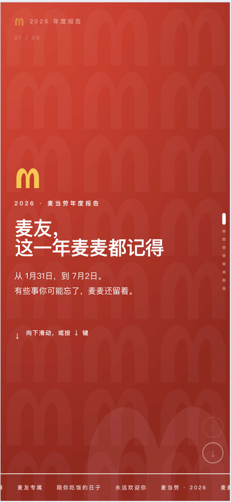
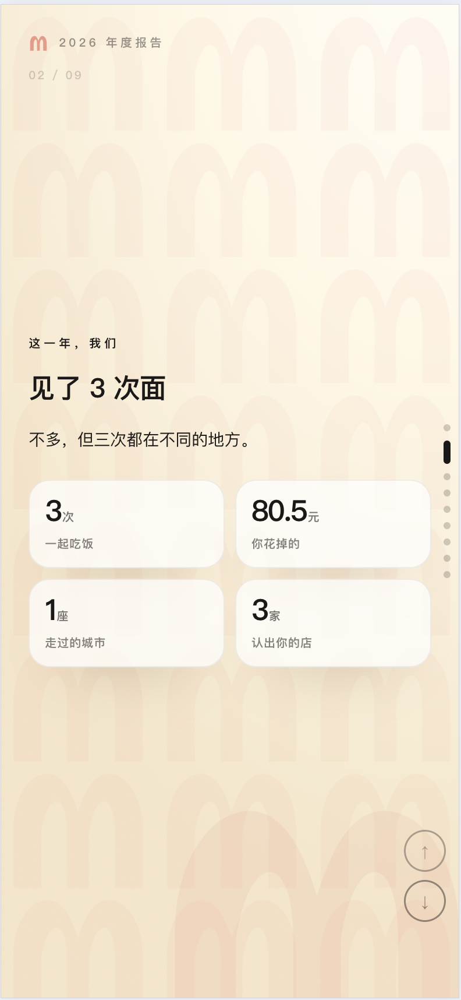
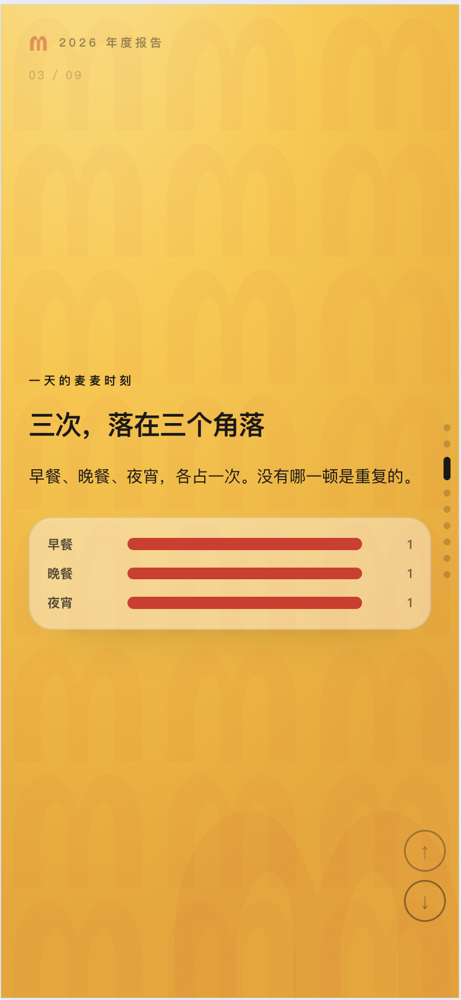
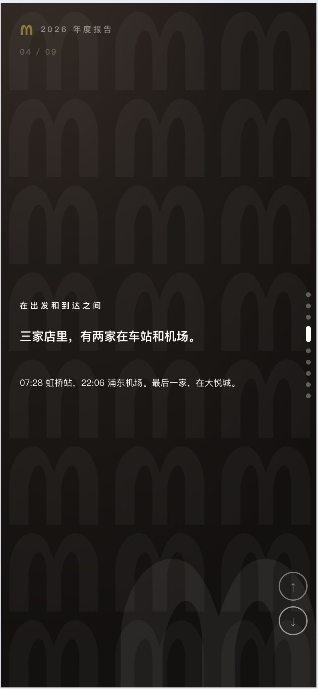
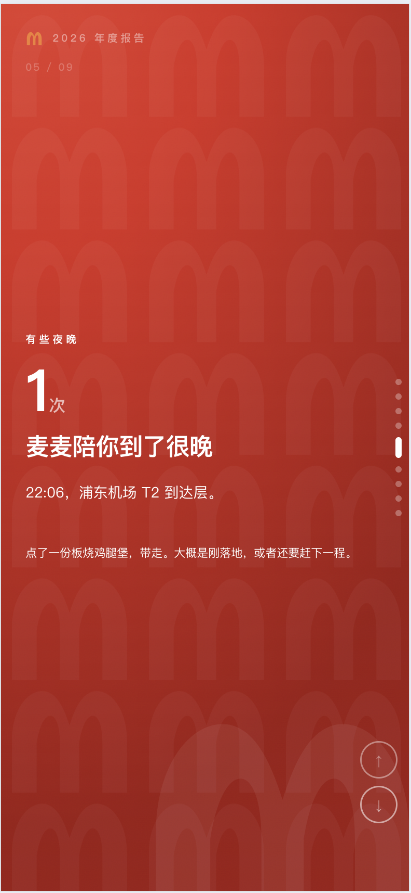
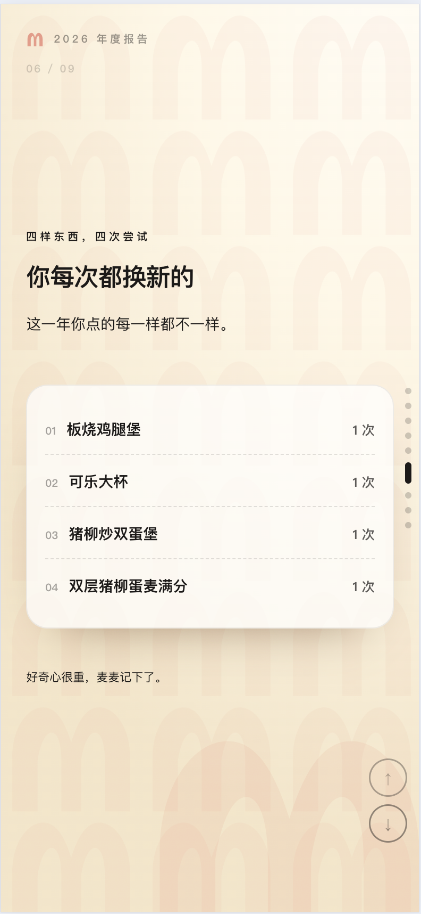
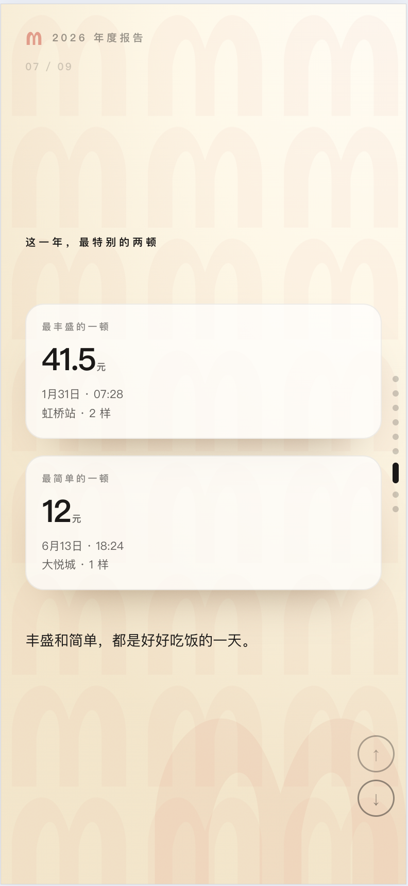
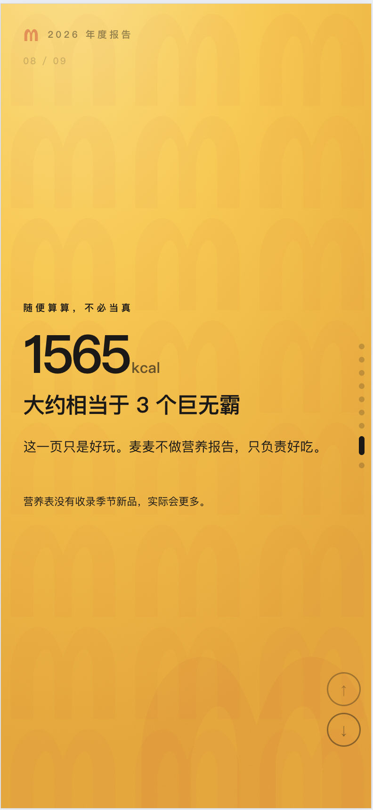
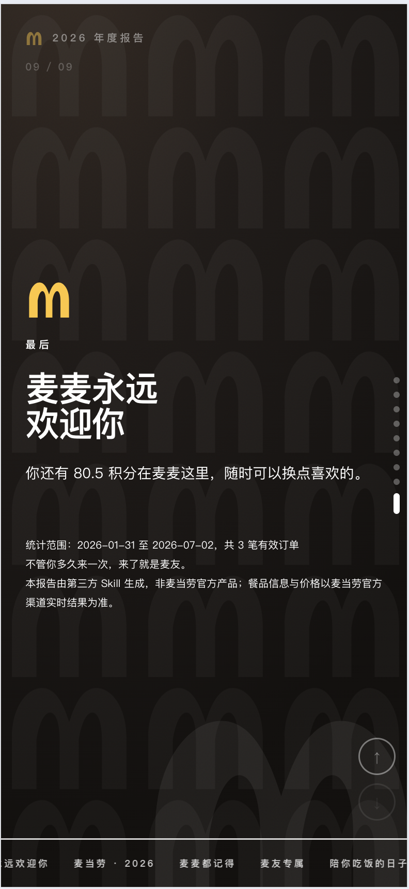

# 麦麦的点名册 · 麦当劳年度报告

> 用麦当劳官方 MCP 的订单数据，挖出属于你的年度故事，生成一份可以翻阅的 HTML 年度报告。
> 麦麦不评判、不算账、不说教，只负责记得。

**这是一个 Agent Skill，不是网页应用。** 触发一次，它会读取你的订单、自己找出值得说的点、生成一个单文件 HTML。



---

## 核心设计：模板只是骨架

这是本项目和其他「年度报告模板」最大的区别：

| | 传统做法 | 本项目 |
|---|---|---|
| 模板 | 每一页的文案和指标都写死 | 只提供 **9 种版式组件**：大数字、数据宫格、分布条、小票清单、卡片墙、左右对比、引言、封面、收尾 |
| 内容 | 所有人看到同一套话术 | **由 Agent 从订单里挖掘洞察后现场生成** |
| 页数 | 固定 N 页 | 由洞察数量决定，通常 6–10 页 |
| 顺序 | 固定 | 由叙事路线决定（时间线 / 地点线 / 人物线） |

换句话说：骨架固定的是**怎么翻页、什么配色、M 标在哪、文字放在哪种版式里**；
内容说的是**这个人今年到底发生了什么**。

---

## 效果演示

以下截图来自真实运行，共 **9 页**，展示骨架的视觉与各类版式：

| | |
|---|---|
| <br>**封面**<br>渐变底 + 平铺 M 水印 + 跑马灯 | <br>**数据宫格**<br>见了 3 次面：3 次 / 80.5 元 / 1 城 / 3 店 |
| <br>**分布条**<br>「三次，落在三个角落」 | <br>**引言页**<br>「三家店里，有两家在车站和机场」 |
| <br>**大数字**<br>1 次深夜：22:06 浦东机场 | <br>**小票清单**<br>四样东西，四次尝试 |
| <br>**左右对比**<br>41.5 元 vs 12 元 | <br>**大数字**<br>1565 kcal ≈ 3 个巨无霸 |
| <br>**收尾**<br>积分、统计口径、免责声明 | |

> 截图中的页序是一次具体运行的结果。换一个账号，页数、顺序、文案都会不同——这正是设计目标。

---

## 它是怎么工作的

```
order-list  ──▶  归一化  ──▶  事实卡  ──▶  挖掘洞察  ──▶  组页 + 写文案  ──▶  填进骨架
                                                                    │
                                    ┌───────────────────────────────┘
                                    ▼
                         mcd-annual-report-<年份>.html
```

1. **取数**：`order-list` 拉全部订单，`query-order` 逐单补优惠、券、取餐方式。
2. **算事实卡**：订单数、总额、时段分布、门店、复购、品类、优惠、取消……
3. **挖洞察**：用一套判断标准筛出 3–6 个「值得单独占一页」的点。
4. **组页**：决定页数、顺序、配色节奏、每页用哪种版式。
5. **写文案**：麦麦的口吻，写发现，不写指标名。

详见 `skills/mcd-annual-report/references/insight-playbook.md`。

### 什么算「值得说」的洞察

判断标准只有两条：**能指认**（说得出哪一天、哪家店、哪一笔）+ **非平凡**（换个人未必成立）。

例如：

- ✅ 「三家店里，有两家在车站和机场。」
- ✅ 「22:06，浦东机场 T2 到达层。」
- ✅ 「四样东西，四次尝试，没有一样重复。」
- ❌ 「你平均每次消费 26.83 元。」——太庸常
- ❌ 「你在午餐时段下过单。」——人人都这样

---

## 目标用户

| 用户 | 场景 |
|---|---|
| **普通麦友** | 年底回顾「我今年在麦当劳吃了什么、在哪儿吃的」 |
| **重度用户** | 想看消费习惯背后的生活轨迹，而不只是账单 |
| **品牌 / 运营** | 需要可复用的用户惊喜体验模板，可嵌入会员运营 |
| **开发者** | 参考如何把 MCP 工具链编排成「取数 → 洞察 → 生成」的完整 Skill |

---

## 安装方法

### 前置条件

- 支持 **Agent Skill** 的客户端（如 Zed）
- 已完成**麦当劳 MCP** 连接与账号授权（能正常调用 `order-list`）
- 无需 npm / pip / 构建步骤

### 放入 Skill 目录

```
你的项目/
├── mcp-config.example.json        ← MCP 配置示例（仅环境变量占位符）
└── skills/
    └── mcd-annual-report/
        ├── SKILL.md
        ├── references/
        │   ├── data-collection.md      ← 字段映射与实测陷阱
        │   ├── insight-playbook.md     ← 洞察挖掘手册
        │   └── report-schema.md        ← 报告数据结构与版式
        └── templates/
            └── report.html             ← 单文件骨架
```

### 让客户端自动发现（可选）

部分客户端只扫描 `.agents/skills/`：

```sh
mkdir -p .agents/skills
ln -s ../../skills/mcd-annual-report .agents/skills/mcd-annual-report
```

---

## 使用示例

### 触发

```
生成我的麦当劳年度报告
```

若客户端未自动发现：

```
按 skills/mcd-annual-report/SKILL.md 生成我的年度报告
```

### 产物

一个**单文件 HTML**，零外部依赖、零网络请求，双击即可打开：

| 操作 | 效果 |
|---|---|
| 向下滚动 / `↓` / `PageDown` | 下一页（scroll-snap 吸附整页） |
| `↑` / `PageUp` | 上一页 |
| 右侧圆点 | 跳转到任意页 |
| 右下角 ↑↓ 按钮 | 上一页 / 下一页 |
| `Home` / `End` | 首页 / 末页 |

页脚会自动标注统计口径，例如：

> 统计范围：2026-01-31 至 2026-07-02，共 3 笔有效订单。

---

## 数据边界

| 能力 | 说明 |
|---|---|
| 时间窗口 | 接口按时间窗口返回，实测可回溯约 265 天，不返回更早年份 |
| 跨年对比 | **做不到**，拿不到上一年数据 |
| 支付方式 | 接口不提供 |
| 取消时刻 | 只有支付截止时间，没有取消时刻 |
| 用户昵称 | MCP 不提供，默认称呼「麦友」 |
| 热量 | 依赖静态营养表，季节新品常缺失，只能做娱乐估算 |

统计范围一律从数据反推（`min(createTime)` ~ `max(createTime)`），不硬编码「本自然年」。

---

## 设计原则

- **内容由数据决定**：没有故事的点，不为它开一页。
- **宁少不凑**：5 页讲透，好过 12 页注水。
- **每个数字都有出处**：能指到具体那一笔订单。
- **金额保留真实小数**：41.5 不是 42。
- **麦麦的语气**：温暖、克制，不做健康评价，也不做消费评价。
- **千人千面是结果，不是口号**：同一份骨架，不同账号会得到不同的页数与叙事。

---

## 项目结构

```
Mc_Annual_Report/
├── README.md
├── CONTEST_DECLARATION.md        ← 参赛声明（内容不可修改）
├── MCP_INTEGRATION.md            ← MCP 集成说明
├── mcp-config.example.json       ← MCP 配置示例（脱敏）
├── .gitignore                    ← 排除生成产物与本地凭证
├── images/                       ← 版式示意 P1–P9
├── mcd-annual-report-2026.html   ← 本地生成的产物（已在 .gitignore 中排除）
└── skills/mcd-annual-report/
    ├── SKILL.md
    ├── references/
    │   ├── data-collection.md
    │   ├── insight-playbook.md
    │   └── report-schema.md
    └── templates/report.html
```

---

## 隐私与合规

报告**只使用**：门店名、金额、下单时间、商品名、订单状态、积分余额。

**绝不写入**：门店地址、收货人姓名与手机号、骑手信息、取餐码、取餐柜密码、二维码、账号 ID、支付 ID、任何 Token。

本项目由参赛者独立开发，**非麦当劳官方产品**。报告输出仅供参考，不构成医疗、营养或其他专业建议；餐品信息、价格及供应状态以麦当劳官方渠道的实时结果为准。

---

## License

见 [LICENSE](LICENSE)。
